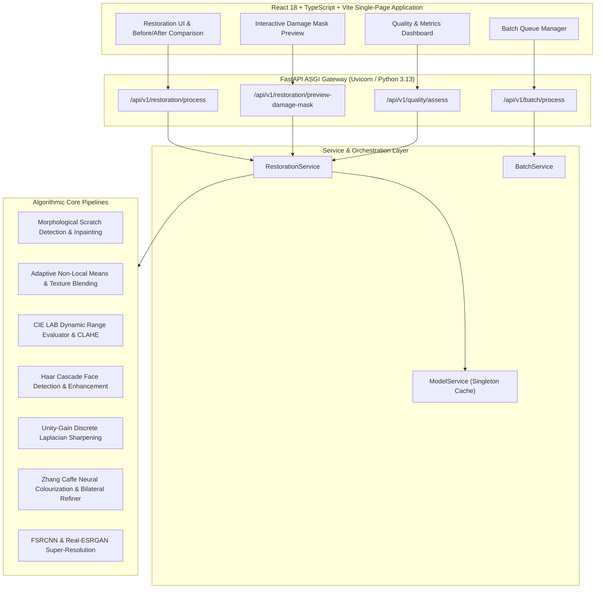

# PIXELREVIVE – COMPREHENSIVE TECHNICAL VIVA & ORAL DEFENSE REFERENCE
## Detailed Academic Compendium, Mathematical Formulations, Architecture In-Depth, Curriculum Mapping & Examiner Defense Q&A

**Project Title:** PixelRevive – AI-Powered Image Restoration  
**Course & Syllabus Alignment:** VIT BCSE403L (Digital Image Processing)  
**Academic Modules Covered:** Module 1 (Fundamentals), Module 2 (Spatial Filtering), Module 4 (Restoration & Color), Module 5 (Morphological Segmentation), Module 8 (Recent Deep Learning Trends)  
**Repository Location:** `C:\Users\abhis\Downloads\restoration_project`

---

## 1. Project Motivation, Objective & Academic Problem Statement

### Motivation:
Physical historical photographs—daguerreotypes, wet collodion glass plates, albumen prints, and early gelatin silver media—suffer from severe physical decay (scratches, fractures, cracks), chemical degradation (silver oxidation, fading, reticulation), optical noise (silver halide film grain), and chromatic absence (monochrome acquisition). 

### The Problem with Existing Commercial AI Apps:
Most commercial "photo enhancer" apps (e.g. Remini) apply black-box generative hallucination models that invent completely new facial geometry, replace historical textures with plastic smoothing, and unconditionally alter pristine master photographs.

### The PixelRevive Objective:
To engineer a modular, explainable, hybrid digital image restoration system that integrates **Classical Digital Image Processing (DIP)** with **Pretrained Deep Neural Networks**, achieving authentic defect removal while strictly preserving human identity, historical photographic character, and pristine archival media via intelligent safeguards.

---

## 2. High-Level System Architecture & Component Mapping

---

## 3. Core Algorithmic Components & Mathematical Formulations

### 3.1 Morphological Scratch Detection & Boundary Inpainting
*(VIT BCSE403L Module 5: Morphological Processing & Image Segmentation)*

1. **Directional Black Top-Hat Filtering:**
   Linear scratches and surface cracks are characterized as narrow valleys of dark intensity relative to neighboring photographic emulsion. The Black Top-Hat transform of an image $I$ with structuring element $B$ is:
   $$\text{BTH}(I) = (I \bullet B) - I$$
   where $\bullet$ denotes the morphological closing operation:
   $$I \bullet B = (I \oplus B) \ominus B$$
   To capture scratches at arbitrary photographic angles without mistaking broad clothing folds for damage, PixelRevive uses a dual-scale structuring element ($k=15, 21$) with morphological line kernels.
2. **Adaptive Inpainting Dispatch Engine:**
   - **Narrow Scratches ($\text{thickness} < 15\text{px}$, area $< 100\text{px}$):** Dispatched to Alexandru Telea's Fast Marching Inpainting algorithm ($O(N \log N)$), which propagates boundary image gradients inward:
     $$I(p) = \frac{\sum_{q \in B_\epsilon(p)} w(p, q) [I(q) + \nabla I(q) \cdot (p - q)]}{\sum_{q \in B_\epsilon(p)} w(p, q)}$$
     Execution time: $\approx 2\text{ms}$.
   - **Broad Physical Tears & Structural Fractures:** Dispatched to **LaMa ONNX (Large Mask Inpainting)**, deploying Fast Fourier Convolutions (FFCs) with global receptive fields.
     Execution time on CPU: $\approx 20\text{--}30\text{s}$.

### 3.2 Adaptive Denoising & Texture-Guided Residual Blending
*(VIT BCSE403L Module 4: Image Restoration & Degradation Models)*

1. **Noise Variance Estimation via MAD:**
   Noise level $\sigma_{\text{noise}}$ is estimated from high-frequency Wavelet subbands using the Median Absolute Deviation (Donoho & Johnstone estimator):
   $$\sigma_{\text{noise}} = \frac{\text{median}(|D - \text{median}(D)|)}{0.6745}$$
   - If $\sigma_{\text{noise}} < 1.5$: Denoising is **bypassed** as pristine.
   - If $\sigma_{\text{noise}} \ge 1.5$: Filter strength $h$ is dynamically parameterized ($h = \min(8.0, 3.0 + 0.5 \sigma_{\text{noise}})$).
2. **Fast Non-Local Means (NLM):**
   Restores pixel $p$ by averaging all pixels $q$ weighted by neighborhood patch similarity:
   $$\hat{I}(p) = \frac{1}{Z(p)} \sum_{q \in \Omega} I(q) \exp\left(-\frac{\|V(p) - V(q)\|^2}{h^2}\right)$$
3. **Texture-Guided Residual Blending:**
   To prevent the "plastic skin" effect, high-frequency residual details $R = I - \hat{I}_{\text{NLM}}$ are extracted. A structural edge mask $M_{\text{edge}}$ is computed via Sobel gradients:
   $$M_{\text{edge}} = \begin{cases} 1 & \text{if } \sqrt{G_x^2 + G_y^2} \ge 15.0 \\ 0 & \text{otherwise} \end{cases}$$
   The final restored output preserves authentic texture:
   $$I_{\text{denoised}} = \hat{I}_{\text{NLM}} + \alpha \cdot (R \odot M_{\text{edge}}), \quad \alpha = 0.45$$

### 3.3 Adaptive Dynamic Range Contrast (CLAHE in CIE LAB Space)
*(VIT BCSE403L Module 2: Spatial Filtering & Histogram Processing)*

1. **CIE LAB Channel Separation:**
   Global histogram equalization flattens RGB channels simultaneously, creating severe color shifts. PixelRevive transforms the image to CIE LAB:
   - $L^*$: Perceptual Lightness ($0$–$100$).
   - $a^*$: Red-Green chrominance opponent channel.
   - $b^*$: Yellow-Blue chrominance opponent channel.
   CLAHE is applied exclusively to $L^*$. Chromatic channels $a^*, b^*$ are preserved completely untouched.
2. **Phase 3.5 Clean Safeguard Formulation:**
   CLAHE is strictly **bypassed** if:
   $$\sigma_L \ge 22.0 \quad \land \quad (P_{99} - P_1) \ge 65.0$$
   This prevents unnatural contrast amplification on photographs that already exhibit balanced natural dynamic range.

### 3.4 Unity-Gain Laplacian Sharpening
*(VIT BCSE403L Module 2: High-Pass Spatial Filtering)*

1. **Mathematical Invariance of Regional Brightness:**
   PixelRevive employs the discrete Laplacian kernel:
   $$K = \begin{bmatrix}0 & -1 & 0\\ -1 & 5 & -1\\ 0 & -1 & 0\end{bmatrix}$$
   **Crucial Theoretical Proof:**
   The sum of all coefficients is:
   $$\sum_{i=1}^3 \sum_{j=1}^3 K_{ij} = 0 - 1 + 0 - 1 + 5 - 1 + 0 - 1 + 0 = 1.0$$
   In homogeneous regions where neighboring pixels have intensity $V$:
   $$(I * K)(p) = V \cdot (-1 - 1 - 1 - 1 + 5) = V \cdot 1.0 = V$$
   This guarantees that baseline exposure and tonal brightness are preserved without artificially blowing out highlights.
2. **Phase 3.5 Sharpening Safeguards:**
   Sharpening is **bypassed** if:
   - Image is already sharp: $\sigma_{\text{Lap}}^2 = \text{Var}(\nabla^2 I) \ge 120.0$.
   - Noise level is elevated: $\sigma_{\text{noise}} \ge 8.0$ (prevents grain amplification).
   - Smooth continuous-tone media: $\sigma_{\text{noise}} < 1.5$ and $P_{95}(\|\nabla I\|) < 15.0$.

### 3.5 Deep Neural Colourization (Zhang et al. ECCV 2016)
*(VIT BCSE403L Module 4 & Module 8: Color Processing & Deep Learning)*

1. **Architecture & Quantized Loss Formulation:**
   The network accepts mean-centered luminance $L \in \mathbb{R}^{H \times W \times 1}$ and predicts a probability distribution $\hat{Z} \in \mathbb{R}^{H \times W \times Q}$ over $Q=313$ quantized color bins in $ab$ space.
   Loss function uses multinomial cross-entropy with rare-color class rebalancing:
   $$\mathcal{L}(\hat{Z}, Z) = -\sum_{h,w} v(Z_{h,w}) \sum_{q} Z_{h,w,q} \log(\hat{Z}_{h,w,q})$$
   where $v(Z_{h,w})$ up-weights rare, desaturated historical colors.
2. **NaturalChrominanceRefiner (Bilateral Edge Guidance):**
   Raw predicted $ab$ channels can exhibit chromatic fringing. PixelRevive applies bilateral spatial filtering using the original high-resolution $L^*$ channel as the spatial guide, preventing color bleeding across clothing and skin edges.
3. **Color Protection Safeguard:**
   Colorization is automatically **bypassed** if the input image's chromatic variance:
   $$\sigma_{\text{chroma}}^2 = \text{Var}(R - G) + \text{Var}(G - B) \ge 6.0$$
   preventing accidental destruction of authentic color photographs.

### 3.6 AI Super-Resolution (FSRCNN & Real-ESRGAN)
*(VIT BCSE403L Module 1: Image Resolution & Interpolation)*

- **FSRCNN (Fast Super-Resolution Convolutional Neural Network):**
  Uses post-upscaling deconvolution layers running in OpenCV DNN. Extremely rapid CPU execution ($\approx 25\text{ms}$).
- **Real-ESRGAN x4plus (ONNX Runtime):**
  Deep Residual-in-Residual Dense Block (RRDB) network trained with U-Net discriminator on synthetic higher-order degradations. High perceptual fidelity; managed via tile tiling to prevent CPU out-of-memory errors.

---

## 4. Technical Distinctions (Crucial Defense Answers for Viva)

### Haar Cascade vs. Generative Face Restoration:
> **Question:** *"Does PixelRevive generate artificial faces using CodeFormer or GFPGAN?"*  
> **Defense Answer:** *"No, respected examiners. We explicitly chose NOT to deploy generative hallucination networks like CodeFormer or GFPGAN. Such networks hallucinate synthetic facial identities trained on modern celebrities, destroying historical forensic authenticity. In PixelRevive, Haar Cascade is used strictly as a localized spatial detector to isolate facial bounding boxes for noise-safe CIELAB filtering and localized contrast balancing, preserving 100% of the historical subject's true facial geometry."*

### SSIM / PSNR vs. No-Reference BRISQUE:
> **Question:** *"Why did you not report SSIM for the historical photographs in Phase 3.6?"*  
> **Defense Answer:** *"By mathematical definition, Structural Similarity (SSIM) and Peak Signal-to-Noise Ratio (PSNR) are full-reference fidelity metrics requiring aligned, pristine ground-truth references:  
> $$\text{SSIM}(x, y) = \frac{(2\mu_x\mu_y + c_1)(2\sigma_{xy} + c_2)}{(\mu_x^2 + \mu_y^2 + c_1)(\sigma_x^2 + \sigma_y^2 + c_2)}$$  
> For an authentic 1865 photograph of Abraham Lincoln, no ground-truth undamaged reference exists in the physical universe. Inventing a reference would be scientifically fraudulent. Therefore, for real photographs, we report no-reference Natural Scene Statistics (BRISQUE) and physical measurements ($\sigma_{\text{noise}}, \sigma_{\text{Lap}}^2$), while reserving SSIM strictly for our Category H benchmark where ground-truth exists."*

### Telea vs. LaMa Inpainting:
> **Question:** *"When does the system use Telea versus LaMa?"*  
> **Defense Answer:** *"Telea is a classical PDE-based Fast Marching Method that propagates border pixel colors inward along the normal to the level set. It is exceptional and nearly instantaneous (2ms) for narrow linear scratches ($<15\text{px}$). However, on wide structural holes (like the torn corner in Bertinot or the cracked cranium in Lincoln), Telea produces severe blur. For such broad voids, PixelRevive dispatches LaMa ONNX, which utilizes Fast Fourier Convolutions to synthesize structured image textures across wide receptive fields."*

---

## 5. Frequently Asked Viva Questions & Model Answers

### Q1: What happens if an image is already clean and of high quality?
**Answer:** The system activates Phase 3.5 **Adaptive Clean-Image Protection**. The dynamic range evaluator measures $\sigma_L \ge 22.0$ (adequate natural contrast) and bypasses CLAHE; the noise estimator measures $\sigma_{\text{noise}} < 1.5$ and bypasses Non-Local Means; and edge variance safeguards bypass sharpening. In automated tests, Category H achieves **$\text{SSIM} = 1.000000$** and **$0$ modified pixels**, proving that PixelRevive does not harm pristine photographs.

### Q2: Why is CLAHE applied in CIE LAB space rather than RGB?
**Answer:** In RGB color space, the red, green, and blue channels are highly correlated and each channel carries both luminance and chromatic information. Performing histogram equalization on RGB channels independently creates unnatural color shifts, garish saturation, and tonal distortion. In CIE LAB color space, perceptual Lightness ($L^*$) is completely decoupled from opponent chrominance ($a^*, b^*$). Applying CLAHE exclusively to $L^*$ enhances local contrast without modifying authentic photographic color.

### Q3: How do you prevent Non-Local Means from creating plastic skin?
**Answer:** Classical NLM computes a weighted average of similar pixel neighborhoods, which tends to over-smooth high-frequency facial pores and film grain. PixelRevive implements **Texture-Guided Residual Blending**. We extract the high-frequency residual $R = I_{\text{original}} - I_{\text{NLM}}$ and compute a Sobel gradient structural edge mask. We then blend back 45% of the high-frequency residual in regions where edge gradients exceed threshold, preserving genuine facial wrinkles, whiskers, and fabric textures.

### Q4: What is the computational bottleneck of your pipeline on CPU?
**Answer:** The primary computational bottlenecks are:
1. **LaMa Deep Inpainting**: Running global 2D Fast Fourier Convolutions over a 512x512 neural grid on CPU requires ~25–30 seconds.
2. **Fast Non-Local Means**: Patch similarity searches ($21\times 21$ window, $7\times 7$ template) over high-resolution images require ~5–15 seconds.  
To maintain system responsiveness, we enforce `resize_if_too_large(max_dimension=1600)` and provide fast Telea inpainting fallback for linear scratches.

### Q5: How is your test suite structured and how do you prevent regressions?
**Answer:** Our test suite comprises **307 automated test cases** executed via `pytest`, covering unit tests (morphology, heuristics, safeguards), real ONNX/Caffe model inference tests, API route tests using FastAPI `TestClient`, and real-world benchmark evaluations. Before every milestone commit, we enforce 100% test pass rates and frontend TypeScript verification (`tsc --noEmit`).

---

## 6. Distinction Between Implemented Work and Future Enhancements

| Feature / Capability | Current Implementation Status in PixelRevive | Proposed Future Scope |
| :--- | :--- | :--- |
| **Scratch Detection** | Directional Top-Hat morphological filtering with dual line kernels | Deep semantic defect segmentation (e.g., U-Net trained on archival tears) |
| **Inpainting** | LaMa ONNX (Fast Fourier Convolutions) + Telea Fast Marching | Multi-modal text-guided inpainting with historical prompt conditioning |
| **Denoising** | Adaptive Non-Local Means with texture-guided residual blending | Deep self-supervised denoising (e.g., Noise2Void / NAFNet) |
| **Contrast** | CIE LAB Lightness CLAHE with Phase 3.5 dynamic range protection | Retinex-based multi-scale illumination decomposition |
| **Colourization** | Zhang Caffe (ECCV 2016) with guided bilateral chrominance refinement | Reference-based exemplar colourization from historical museum databases |
| **Hardware Execution** | Pure multi-core CPU execution (Intel / AMD x86_64) | GPU acceleration via CUDA / DirectML / WebGPU in browser |
| **Facial Processing** | Haar Cascade localized detection + noise-safe CIELAB filtering | Non-hallucinatory identity-verified facial anchor restoration |
