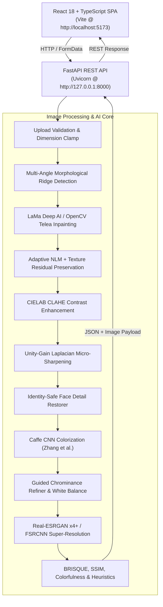

# 🎨 PixelRevive – AI-Powered Image Restoration

[](LICENSE)
[](https://www.python.org/downloads/)
[](https://fastapi.tiangolo.com)
[](https://react.dev/)
[](https://www.typescriptlang.org/)
[](https://vitejs.dev/)

**PixelRevive** is a modern, modular, production-grade image restoration and colorization application designed to restore degraded, scratched, noisy, faded, and vintage monochrome photographs.

It combines classical digital image processing algorithms (Non-Local Means denoising, CLAHE contrast recovery, Laplacian sharpening, directional morphology, edge-preserving guided filters) with state-of-the-art pretrained deep learning models:
- **LaMa (Large Mask Inpainting with Fast Fourier Convolutions)** for artifact-free crack and scratch elimination.
- **Zhang et al. ECCV 2016** deep convolutional network for chromatic synthesis.
- **Natural Chrominance Refiner** with guided edge boundary snapping, shadow/highlight desaturation, and color temperature tuning.
- **Identity-Preserving Face Detail Restorer** with landmark-localized contrast recovery and unsharp masking.
- **Real-ESRGAN x4plus & FSRCNN** deep super-resolution neural networks.

Built with a decoupled, high-performance architecture: an asynchronous **FastAPI** backend serving an interactive, professional light-themed **React 18 + TypeScript** Single Page Application (SPA).

---

## Architecture Overview



### Decoupled Stack
- **Frontend SPA (`frontend/`)**: React 18, TypeScript, modern desktop light theme, Lucide icons, split-view comparison slider, real-time quality dashboard, and degradation analysis panels.
- **Backend API (`backend/`)**: FastAPI, Starlette, Pydantic v2 schemas, asynchronous background thread pools, and structured REST endpoints (`/api/v1/restoration/*`, `/api/v1/models/*`, `/api/v1/health`).
- **Processing Core (`backend/src/processing/`)**: OpenCV Contrib (`opencv-python-headless`), ONNX Runtime (`onnxruntime`), NumPy, Pillow, SciPy, and Caffe DNN engine.

---

## Key Features

- **Independently Configurable Pipeline**: Toggle classical restoration (denoising, contrast enhancement, sharpening) and deep learning colorization independently or execute them together.
- **Deep AI Inpainting (LaMa FFC)**: Pretrained Large Mask Inpainting using Fast Fourier Convolutions (`lama_fp32.onnx`), eliminating large diagonal/horizontal cracks across complex photographic textures without local blur. Classical OpenCV Telea and Navier-Stokes PDE engines available as fallbacks.
- **Adaptive Scratch Ridge Detection**: Multi-orientation morphological kernels with differential extremum contrast checking, resolving false-rejection of scratches on 3D face lighting gradients while strictly rejecting genuine step edges and facial features.
- **Detail-Preserving Adaptive Denoising**: Noise-calibrated Non-Local Means filtering coupled with high-frequency residual blending (`preserve_texture=True`), preserving authentic photographic grain, skin pores, and fabric textures while suppressing sensor noise.
- **Identity-Safe Face Detail Restorer**: Automatic facial feature detection with localized CLAHE, unsharp masking on facial landmarks (eyes, mouth, nose), and smooth elliptical feathering to retain original facial identity without plastic smoothing.
- **Natural Colorization Refiner**: Edge-preserving guided filtering (`cv2.ximgproc.guidedFilter`) mapping chrominance contours to structural luminance, LAB saturation calibration, shadow/highlight desaturation, and color temperature adjustment (cool/warm balance).
- **Dual AI Super-Resolution**: High-fidelity 2× and 4× image upscaling via **Real-ESRGAN x4plus** (deep residual UNet) and **FSRCNN** (fast neural network), protected by 4096px / 12 MP safety budgets.
- **Interactive Split Comparison**: Full-featured drag-to-reveal comparison slider with dual-viewport alignment and real-time zoom.
- **Batch Processing**: Concurrently upload up to 10 images with individual progress tracking, individual downloads, and combined ZIP download.
- **Advanced Image Quality Assessment**: Multi-metric evaluation subsystem featuring no-reference BRISQUE perceptual distortion scoring, reference-based Structural Similarity Index (SSIM) with per-channel breakdown, and Hasler-Süsstrunk chromatic dispersion measurement.
- **Exhaustive Automated Test Suite**: 265 automated unit, integration, and route validation tests with 100% pass rate.

---

## Computer Vision & Deep Learning Pipeline

1. **Preprocessing & Clamping**: Validates upload headers and MIME types, normalizes orientations, and resizes images exceeding 1600px on the longest axis while preserving aspect ratio.
2. **Classical & Deep Restoration Stage**:
   - **Scratch Detection & Inpainting**: Directional morphological black-hat and white-hat operators (horizontal, vertical, ~45°, ~135°) detect hairline cracks and physical blemishes. Differential extremum analysis validates ridges against local lighting gradients. Reconstructed using **LaMa Deep AI** (Fast Fourier Convolutions) or OpenCV Telea / Navier-Stokes PDE solvers.
   - **Adaptive Denoising with Texture Residuals**: Measures noise variance ($\hat{\sigma}$) via Immerkær's Laplacian operator. Adapts Non-Local Means filter strength ($h \in [3, 15]$) and blends high-frequency texture residuals back into the image to prevent waxy skin or over-smoothed paper grain.
   - **Contrast Enhancement**: Contrast Limited Adaptive Histogram Equalization (CLAHE) applied specifically to the lightness ($L$) channel in LAB color space, avoiding color shifts.
   - **Sharpening**: Unity-gain Laplacian kernel restores fine micro-contrasts without altering overall luminance.
   - **Face Detail Restoration**: Haar Cascade localized facial extraction applies selective adaptive contrast and unsharp masking on landmark features, smoothly feathered back into the photograph.
3. **CIE LAB Chrominance Synthesis**:
   - Separates lightness ($L \in [0, 100]$) from chromatic channels ($a, b$).
   - Lightness channel is scaled via `render_factor` ($10 \le \text{render\_factor} \le 40$, default 14 for 224×224) and evaluated through the Zhang et al. 8-block CNN to predict chromatic distributions over 313 quantized $(a, b)$ bins.
4. **Guided Chrominance Refinement**:
   - **Edge Snapping**: Guided filter uses the high-resolution original $L$ channel as structural guide to snap predicted $a, b$ boundaries cleanly to photographic contours, eliminating color bleeding.
   - **Chroma Saturation & White Balance**: Calibrates saturation (default 0.85) to produce authentic historical skin and scenery tones; applies color temperature shifting for warm/cool compensation.
   - **Shadow/Highlight Chroma Attenuation**: Desaturates extreme dark and specular regions to avoid chromatic blotches.
5. **AI Super-Resolution**:
   - When `upscale=true`, reconstructs fine spatial details at 2× or 4× resolution using **Real-ESRGAN x4plus** (deep residual network) or **FSRCNN** (compact neural network). Enforces a 4096px maximum dimension and 12 MP pixel budget.

---

## 🎓 Academic Syllabus Mapping: VIT BCSE403L Digital Image Processing

PixelRevive's engineering architecture directly implements and demonstrates core concepts from all 6 modules of the **VIT BCSE403L Digital Image Processing** syllabus:

| Module | Syllabus Topic | Mathematical / Algorithmic Concept | Implementation File in PixelRevive |
|---|---|---|---|
| **Module 1: Fundamentals of Image Processing** | Image representation, sampling, quantization, color models | 2D discrete coordinate mapping, CIE LAB color space decomposition ($L \in [0, 100]$, $a, b \in [-128, 127]$), render factor quantization ($16 \times f$) | `backend/src/processing/colorization/models/zhang_caffe.py`<br/>`src/image_utils.py` |
| **Module 2: Image Transforms** | Fourier transforms, frequency domain representations, spatial frequencies | 2D Fast Fourier Convolutions (FFC) with spectral transform blocks capturing periodic image components and global receptive fields for inpainting | `backend/src/processing/restoration/inpainter_lama.py`<br/>`model/lama_fp32.onnx` |
| **Module 3: Image Enhancement** | Spatial domain filtering, histogram equalization, unsharp masking | CLAHE (Contrast-Limited Adaptive Histogram Equalization) on $L$ channel, Laplacian second-derivative unsharp masking ($\nabla^2 f$), high-frequency residual blending | `backend/src/processing/restoration/denoiser.py`<br/>`backend/src/processing/restoration/face_restorer.py`<br/>`src/enhancer.py` |
| **Module 4: Image Restoration & Degradation Models** | Noise models, noise estimation, Non-Local Means, image inpainting | Immerkær blind Laplacian noise variance estimation ($\hat{\sigma}$), Non-Local Means weighted averaging ($h \propto \sigma$), partial differential equations (Telea/Navier-Stokes) and deep LaMa inpainting | `backend/src/processing/restoration/denoiser.py`<br/>`backend/src/processing/restoration/scratch_repair.py`<br/>`backend/src/processing/evaluation/heuristics.py` |
| **Module 5: Color Image Processing** | Chrominance processing, pseudo-coloring, color transformation, edge-preserving smoothing | Deep CNN chrominance probability distribution mapping over 313 bins, edge-preserving guided filtering ($q_i = a_k I_i + b_k$), LAB saturation scaling, color temperature balance | `backend/src/processing/colorization/models/zhang_caffe.py`<br/>`backend/src/processing/colorization/factory.py`<br/>`backend/src/processing/evaluation/colorfulness.py` |
| **Module 6: Morphological Image Processing & Object Detection** | Structuring elements, top-hat/black-hat, connected components, feature detection | Multi-angle linear structuring elements (horizontal, vertical, $\pm 45^\circ$), morphological black-hat/top-hat filtering, connected-component area filtering, Haar Cascade face detection with elliptical soft alpha feathering | `backend/src/processing/restoration/scratch_repair.py`<br/>`backend/src/processing/restoration/face_restorer.py` |

---

## Pretrained AI Model Catalog

All models run efficiently on **CPU Execution Providers** without requiring dedicated GPU hardware.

| Model Name | Task | Architecture | File Path | File Size | License | Source |
|---|---|---|---|---|---|---|
| **LaMa Inpainter** | Archival scratch & defect removal | Fast Fourier Convolutions (FFC) | `model/lama_fp32.onnx` | ~208 MB | Apache-2.0 | [Carve/LaMa-ONNX](https://huggingface.co/Carve/LaMa-ONNX) |
| **Real-ESRGAN x4plus** | High-fidelity super-resolution (2×/4×) | Residual-in-Residual Dense Block (RRDB) | `model/realesrgan-x4plus.onnx` | ~67 MB | BSD-3-Clause | [alegauss/modelado-models](https://huggingface.co/alegauss/modelado-models) |
| **Zhang Colorizer** | Historical B&W photo colorization | 8-Block Deep Convolutional Network | `model/colorization_release_v2.caffemodel` | ~123 MB | BSD-2-Clause | [Zhang et al. ECCV 2016](http://eecs.berkeley.edu/~rich.zhang/projects/2016_colorization/) |
| **Colorizer Topology** | Model architecture definition | Caffe Prototxt Specification | `model/colorization_deploy_v2.prototxt` | ~10 KB | BSD-2-Clause | [Zhang et al. Official](https://github.com/richzhang/colorization) |
| **Cluster Centers** | Quantized chromatic $(a, b)$ centroids | NumPy 313-point coordinate array | `model/pts_in_hull.npy` | ~5 KB | BSD-2-Clause | [Zhang et al. Official](https://github.com/richzhang/colorization) |
| **FSRCNN x2** | Fast 2× neural super-resolution | Compact convolutional network | `model/FSRCNN_x2.pb` | ~40 KB | Apache-2.0 | [Saafke/FSRCNN_Tensorflow](https://github.com/Saafke/FSRCNN_Tensorflow) |
| **FSRCNN x4** | Fast 4× neural super-resolution | Compact convolutional network | `model/FSRCNN_x4.pb` | ~40 KB | Apache-2.0 | [Saafke/FSRCNN_Tensorflow](https://github.com/Saafke/FSRCNN_Tensorflow) |
| **BRISQUE Quality SVM** | No-reference distortion assessment | Pretrained Support Vector Machine | `model/brisque_model_live.yml` | ~150 KB | BSD-3-Clause | [OpenCV Contrib Quality](https://github.com/opencv/opencv_contrib) |
| **BRISQUE Ranges** | Feature normalization vectors | YAML normalization bounds | `model/brisque_range_live.yml` | ~3 KB | BSD-3-Clause | [OpenCV Contrib Quality](https://github.com/opencv/opencv_contrib) |
| **Face Cascade** | Localized face & landmark detection | Haar Feature-based Cascade Classifier | `haarcascade_frontalface_default.xml` | ~900 KB | BSD-3-Clause | OpenCV Built-in Data |

---

## Project Structure

```text
restoration_project/
├── backend/                  # FastAPI Application
│   ├── src/
│   │   ├── api/              # REST Endpoints (analysis, batch, health, models, quality, restoration)
│   │   ├── core/             # Configuration, logging, exception handlers
│   │   ├── processing/       # Restoration algorithms & deep learning models
│   │   │   ├── colorization/ # Zhang et al. Caffe engine & factory
│   │   │   ├── evaluation/   # BRISQUE, SSIM, Colorfulness, and heuristics
│   │   │   └── restoration/  # LaMa inpainter, Real-ESRGAN, face restorer, scratch repair, denoiser
│   │   ├── schemas/          # Pydantic request and response contracts
│   │   ├── services/         # Application orchestrator services
│   │   └── main.py           # FastAPI ASGI entrypoint
│   └── tests/                # Comprehensive test suites
│
├── frontend/                 # React 18 + TypeScript SPA
│   ├── src/
│   │   ├── components/       # UI components (Controls, SplitView, Slider, Metrics, Analysis, Batch)
│   │   ├── pages/            # SingleRestorationView, BatchRestorationView, AboutModal
│   │   ├── services/         # Typed API client
│   │   ├── styles/           # Modern light design system tokens and layout
│   │   ├── types/            # TypeScript schemas matching Pydantic models
│   │   └── App.tsx           # Application navigation root
│   ├── vite.config.ts        # Vite configuration with API proxy
│   └── package.json
│
├── model/                    # Deep Learning & Quality Model Assets
│   ├── colorization_deploy_v2.prototxt
│   ├── pts_in_hull.npy
│   ├── colorization_release_v2.caffemodel
│   ├── FSRCNN_x2.pb
│   ├── FSRCNN_x4.pb
│   ├── brisque_model_live.yml
│   └── brisque_range_live.yml
│
├── tests/                    # 265 automated backend tests (100% pass rate)
├── pyproject.toml            # Project configuration and pytest settings
├── requirements.txt          # Python runtime dependencies
└── README.md                 # Complete documentation
```

---

## Installation & Setup

### Prerequisites
- **Python**: 3.12+ or 3.13+ installed
- **Node.js**: v18+, v20+, or v22+ with `npm`

### 1. Setup Python Virtual Environment

```powershell
# In PowerShell:
python -m venv .venv
.\.venv\Scripts\activate
pip install -r requirements.txt
```

*(On Linux / macOS: `source .venv/bin/activate` followed by `pip install -r requirements.txt`)*

### 2. Setup React Frontend

```powershell
npm --prefix frontend install
```

---

## Running the Application

### 1. Start the FastAPI Backend

```powershell
.\.venv\Scripts\python.exe -m uvicorn backend.src.main:app --host 127.0.0.1 --port 8000 --reload
```

- **API Base URL**: `http://127.0.0.1:8000`
- **Interactive Swagger UI**: `http://127.0.0.1:8000/docs`
- **Interactive ReDoc**: `http://127.0.0.1:8000/redoc`
- **Health Check**: `http://127.0.0.1:8000/api/v1/health`

### 2. Start the React Frontend

In a separate terminal:

```powershell
npm --prefix frontend run dev
```

- **Frontend Application**: `http://localhost:5173`
- The Vite development server automatically proxies `/api/*` requests to `http://127.0.0.1:8000`.

---

## Testing & Quality Assurance

### Backend Automated Test Suite (265 Tests – 100% Passing)

Run the full automated test suite:

```powershell
.\.venv\Scripts\python.exe -m pytest tests/ -v
```

Specialized test suites:
- `tests/unit/test_lama_inpainting.py`: Fast Fourier Convolution tensor normalization and inpainting contracts.
- `tests/unit/test_realesrgan_sr.py`: Real-ESRGAN 4× native inference and 2× Lanczos downsampling.
- `tests/unit/test_face_restorer.py`: Landmark localization and soft feathering.
- `tests/unit/test_colorization_refiner.py`: Guided chrominance boundary snapping and saturation scaling.
- `tests/unit/test_scratch_repair.py`: Morphological directional ridge extraction and IQR validation.
- `tests/unit/test_quality_metrics.py`: BRISQUE, SSIM, and Colorfulness.
- `tests/api/*`: FastAPI route validation, upload bounds, and batch processing.

### Frontend Static Verification & Production Build

```powershell
npm --prefix frontend run type-check
npm --prefix frontend run build
```

---

## API Reference Summary

| Method | Endpoint | Description |
|---|---|---|
| `GET` | `/` | Root API service identity and health link |
| `GET` | `/api/v1/health` | Comprehensive system health, uptime, and host details |
| `GET` | `/api/v1/models` | Discover registered colorization models, metadata, parameters, and readiness |
| `GET` | `/api/v1/models/status` | Model weights presence, download status, and readiness |
| `POST`| `/api/v1/restoration/analyze` | Image quality diagnosis and rule-based recommendations |
| `POST`| `/api/v1/restoration/quality` | Advanced quality assessment (BRISQUE, SSIM, Colorfulness) |
| `POST`| `/api/v1/restoration/process` | Single-image restoration with LaMa, Face Restore, Real-ESRGAN, and Natural Colorization |
| `POST`| `/api/v1/restoration/batch` | Multi-image batch processing (up to 10 files) with in-memory ZIP download |

---

## License & Attribution

- **Source Code**: Licensed under the [MIT License](LICENSE).
- **LaMa (Fast Fourier Convolutions)**: Suvorov et al., *"Resolution-robust Large Mask Inpainting with Fourier Convolutions"*, WACV 2022 ([Apache-2.0](https://github.com/advimman/lama/blob/main/LICENSE)).
- **Real-ESRGAN**: Wang et al., *"Real-ESRGAN: Training Real-World Blind Super-Resolution with Pure Synthetic Data"*, ICCVW 2021 ([BSD-3-Clause](https://github.com/xinntao/Real-ESRGAN/blob/master/LICENSE.txt)).
- **Pretrained Colorization Model**: Zhang, Isola, and Efros, *"Colorful Image Colorization"*, ECCV 2016 ([BSD-2-Clause](https://github.com/richzhang/colorization/blob/master/LICENSE)).
- **Pretrained Super-Resolution Models**: Dong, Loy, and Tang, *"Accelerating the Very Deep Convolutional Networks for Practical Image Restoration"*, ECCV 2016. TensorFlow model port by [Saafke/FSRCNN_Tensorflow](https://github.com/Saafke/FSRCNN_Tensorflow) ([Apache-2.0](https://github.com/Saafke/FSRCNN_Tensorflow/blob/master/LICENSE)).
- **BRISQUE Quality Assessment**: Mittal, Moorthy, and Bovik, *"No-Reference Image Quality Assessment in the Spatial Domain"*, IEEE TIP 2012 ([BSD-3-Clause](https://github.com/opencv/opencv_contrib/blob/4.x/LICENSE)).
- **SSIM Quality Assessment**: Wang, Bovik, Sheikh, and Simoncelli, *"Image Quality Assessment: From Error Visibility to Structural Similarity"*, IEEE TIP 2004.
- **Colorfulness Metric**: Hasler and Süsstrunk, *"Measuring Colorfulness in Natural Images"*, SPIE Human Vision and Electronic Imaging VIII, 2003.

```bibtex
@inproceedings{suvorov2022resolution,
  title={Resolution-robust Large Mask Inpainting with Fourier Convolutions},
  author={Suvorov, Roman and Logacheva, Elizaveta and Mashikhin, Anton and Remizova, Anastasia and Ashukha, Arsenii and Silvestrov, Aleksei and Kong, Naejin and Goka, Harshith and Park, Kiwoong and Lempitsky, Victor},
  booktitle={WACV},
  year={2022}
}

@inproceedings{wang2021realesrgan,
  title={Real-ESRGAN: Training Real-World Blind Super-Resolution with Pure Synthetic Data},
  author={Wang, Xintao and Xie, Liangbin and Dong, Chao and Shan, Ying},
  booktitle={ICCVW},
  year={2021}
}

@inproceedings{zhang2016colorful,
  title={Colorful Image Colorization},
  author={Zhang, Richard and Isola, Phillip and Efros, Alexei A},
  booktitle={ECCV},
  year={2016}
}

@inproceedings{dong2016accelerating,
  title={Accelerating the Very Deep Convolutional Networks for Practical Image Restoration},
  author={Dong, Chao and Loy, Chen Change and Tang, Xiaoou},
  booktitle={ECCV},
  year={2016}
}

@article{mittal2012no,
  title={No-Reference Image Quality Assessment in the Spatial Domain},
  author={Mittal, Anish and Moorthy, Anush Krishna and Bovik, Alan Conrad},
  journal={IEEE Transactions on Image Processing},
  volume={21},
  number={12},
  pages={4695--4708},
  year={2012}
}

@article{wang2004image,
  title={Image Quality Assessment: From Error Visibility to Structural Similarity},
  author={Wang, Zhou and Bovik, Alan C and Sheikh, Hamid R and Simoncelli, Eero P},
  journal={IEEE Transactions on Image Processing},
  volume={13},
  number={4},
  pages={600--612},
  year={2004}
}
```

---

## Author

**Vishal Koripala**  
AI & Computer Vision Practitioner
