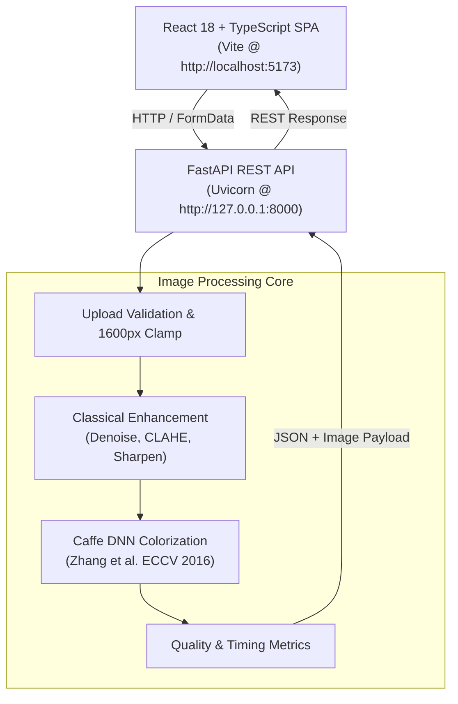

# 🎨 PixelRevive – AI-Powered Image Restoration

[](LICENSE)
[](https://www.python.org/downloads/)
[](https://fastapi.tiangolo.com)
[](https://react.dev/)
[](https://www.typescriptlang.org/)
[](https://vitejs.dev/)

**PixelRevive** is an end-to-end photo restoration and colorization application. It combines classical computer vision techniques (Non-Local Means denoising, CLAHE contrast enhancement, Laplacian sharpening) with a deep convolutional neural network (Zhang et al., ECCV 2016) to restore degraded historical photographs and synthesize plausible, vivid colors.

Built with a decoupled, high-performance architecture: a **FastAPI** asynchronous backend serving an interactive **React 18 + TypeScript** Single Page Application (SPA).

---

## Architecture Overview



### Decoupled Stack
- **Frontend SPA (`frontend/`)**: React 18, TypeScript, Tailwind CSS, Lucide icons, and an interactive before/after split slider.
- **Backend API (`backend/`)**: FastAPI, Starlette, Pydantic schemas, asynchronous file handling, and structured REST endpoints (`/api/v1/process`, `/api/v1/batch/process`, `/api/v1/health`, `/api/v1/models/status`).
- **Processing Engine (`src/` & `backend/src/processing/`)**: OpenCV (`opencv-python-headless`), NumPy, and Caffe deep learning model loaded via OpenCV's `dnn` module.

> **Note on Architecture Evolution:** Streamlit prototype (`app.py`) was formally retired in Phase 4. React + TypeScript with FastAPI is now the sole production interface.

---

## Key Features

- **Independently Configurable Pipeline**: Toggle classical restoration (denoising, contrast enhancement, sharpening) and deep learning colorization independently or execute them together.
- **Deep Learning Colorization**: Employs the Zhang et al. (2016) architecture via OpenCV `dnn`, predicting color distributions across 313 quantized $(a, b)$ bins conditioned exclusively on the CIE LAB lightness channel ($L$).
- **Interactive Split Comparison**: Full-featured drag-to-reveal comparison slider with dual-viewport alignment and real-time zoom.
- **Batch Processing**: Concurrently upload up to 10 images with individual progress tracking, individual downloads, and combined ZIP download.
- **Production Validation**: Strict validation for image format (`.jpg`, `.jpeg`, `.png`, `.webp`), mime-type, 25 MB payload limit, and automatic aspect-preserving downscaling for images exceeding 1600px.
- **Real-Time Quality Metrics**: Execution latency breakdown (ms), inference device detection (CPU/CUDA), and before/after heuristic contrast and sharpness deltas.
- **Archival Scratch Repair & Inpainting**: Multi-orientation morphological detection (horizontal, vertical, diagonal) and OpenCV inpainting (`INPAINT_TELEA`) with safety coverage guards and ridge vs step-edge false-positive rejection.
- **AI Super-Resolution**: Optional 2× and 4× image upscaling via OpenCV DNN Super Resolution using pre-trained FSRCNN models, protected by strict 4096px dimension and 12 MP memory safety budgets.
- **Colorization Tuning & Model Registry**: Configurable rendering factor ($10 \le \text{render\_factor} \le 40$, default 14) controlling internal network resolution, paired with an extensible, thread-safe `ColorizerFactory` supporting structured model metadata discovery and singleton reuse.
- **Advanced Image Quality Assessment**: Multi-metric evaluation subsystem featuring no-reference BRISQUE perceptual distortion scoring, reference-based Structural Similarity Index (SSIM) with per-channel breakdown, and Hasler-Süsstrunk chromatic dispersion measurement.
- **Exhaustive Automated Test Suite**: 248 automated unit, integration, and route validation tests with 100% pass rate.

---

## Computer Vision & Deep Learning Pipeline

1. **Preprocessing**: Validates upload headers and dimensions, normalizes orientations, and resizes images exceeding 1600px on the longest axis while preserving aspect ratio.
2. **Classical Restoration**:
   - **Archival Scratch Repair & Inpainting (Optional)**: When `repair=true`, detects thin localized scratches and emulsion cracks using directional morphological black-hat and white-hat operators (horizontal, vertical, ~45°, ~135°). Geometric connected-component analysis and neighborhood interquartile range (IQR) checks reject step edges, eyes, hair, and textured patterns. Reconstructs defects using OpenCV Telea Fast Marching Method (`cv2.INPAINT_TELEA`, radius 2–5 px). Disabled by default (`repair=false`) to preserve genuine image details. Includes a 5% coverage safety guard that skips inpainting if marked area exceeds safe limits.
   - **Adaptive Denoising**: Intelligently measures image noise variance ($\hat{\sigma}$) via an Immerkær Laplacian residual operator; skips/minimizes filtering on clean images to preserve micro-textures ($h=0$ to $3$), and applies adaptive Non-Local Means ($h=7$ to $16$) on noisy inputs.
   - **Contrast Enhancement**: Contrast Limited Adaptive Histogram Equalization (CLAHE) applied specifically to the lightness ($L$) channel in LAB color space, avoiding artificial color saturation.
   - **Sharpening**: Unity-gain Laplacian kernel restores fine micro-contrasts lost during denoising without introducing clipping or brightness drift.
3. **LAB Color Space Isolation**: Separates lightness ($L \in [0, 100]$) from chromatic channels ($a, b$).
4. **CNN Color Inference**: The lightness channel is scaled (at native 224×224 or configured via `render_factor` $\in [10, 40]$) and fed into the 8-block convolutional architecture to predict chromatic distributions over 313 quantized bins.
5. **Reconstruction**: Quantized bins are mapped back to continuous $a, b$ values, fused with the original enhanced $L$ channel, and transformed back to BGR/RGB for display and download.
6. **AI Super-Resolution (Optional)**: When `upscale=true`, reconstructs high-frequency details at 2× or 4× resolution using OpenCV DNN Super Resolution and FSRCNN models. Enforces a 4096px maximum dimension and 12 MP pixel budget to safeguard CPU resources. Disabled by default (`upscale=false`).

---

## Project Structure

```text
restoration_project/
├── backend/                  # FastAPI Application
│   ├── src/
│   │   ├── api/routes/       # Health, status, processing, and batch endpoints
│   │   ├── core/             # App settings, CORS, and logging configuration
│   │   ├── models/           # Pydantic request/response schemas
│   │   ├── processing/       # Engine adapters and colorization bridges
│   │   └── main.py           # FastAPI entrypoint and lifespan handlers
│   └── tests/                # Backend unit and integration tests (31 tests)
│
├── frontend/                 # React 18 + TypeScript SPA
│   ├── src/
│   │   ├── components/       # UI components (Header, Dropzone, Viewer, Metrics, Batch)
│   │   ├── hooks/            # Custom hooks (useImageProcessing, useBatchProcessing)
│   │   ├── services/         # Axios API client and proxy routing
│   │   ├── types/            # TypeScript interfaces and API models
│   │   ├── App.tsx           # Application root
│   │   └── main.tsx          # React DOM entrypoint
│   ├── vite.config.ts        # Vite configuration with `/api` reverse proxy
│   └── package.json
│
├── src/                      # Core Classical CV & Model Download Engine
│   ├── colorizer.py          # Zhang et al. Caffe inference execution
│   ├── enhancer.py           # Denoising, CLAHE, and sharpening algorithms
│   ├── pipeline.py           # Pipeline orchestration and stage execution
│   ├── image_utils.py        # Image decoding, base64 encoding, ZIP bundling
│   ├── metrics.py            # Sharpness/contrast delta heuristics
│   ├── model_downloader.py   # Automated Caffe weights download utility
│   └── config.py             # Default paths, buffer limits, and model constants
│
├── model/                    # Caffe Model Assets
│   ├── colorization_deploy_v2.prototxt
│   ├── pts_in_hull.npy
│   └── colorization_release_v2.caffemodel  (123 MB weights file)
│
├── tests/                    # Core Engine Test Suite (53 tests)
├── pyproject.toml            # Project configuration and pytest settings
├── requirements.txt          # Python backend runtime dependencies
├── package.json              # Workspace root scripts
└── README.md
```

---

## Installation & Setup

### Prerequisites
- **Python**: 3.12+ installed
- **Node.js**: v18+ or v20+ with `npm`

### 1. Clone Repository & Setup Python Environment

```bash
git clone https://github.com/vishalkoripala/opencv-colorization-project.git
cd opencv-colorization-project

# Create virtual environment
python -m venv .venv

# Activate virtual environment
# Windows (PowerShell / Command Prompt):
.\.venv\Scripts\activate
# Linux / macOS:
source .venv/bin/activate

# Install backend dependencies
pip install -r requirements.txt
```

### 2. Model Weights Setup

The model architecture definition (`colorization_deploy_v2.prototxt`), cluster centers (`pts_in_hull.npy`), FSRCNN super-resolution models (`FSRCNN_x2.pb`, `FSRCNN_x4.pb`), and BRISQUE model assets (`brisque_model_live.yml`, `brisque_range_live.yml`) are committed in `model/`.

- **Colorization Model**: Pretrained Caffe weights (`colorization_release_v2.caffemodel`, ~123 MB) can be downloaded automatically on first inference, or manually placed in `model/`:
  - **Source**: [Zhang et al. Official Release](http://eecs.berkeley.edu/~rich.zhang/projects/2016_colorization/files/demo_v2/colorization_release_v2.caffemodel)
  - **Destination Path**: `model/colorization_release_v2.caffemodel`
- **Super-Resolution Models**: FSRCNN 2× and 4× models (~40 KB each) in `model/`:
  - **Source**: [Saafke/FSRCNN_Tensorflow](https://github.com/Saafke/FSRCNN_Tensorflow) (Apache-2.0 License)
  - **Destination Paths**: `model/FSRCNN_x2.pb`, `model/FSRCNN_x4.pb`
- **BRISQUE Quality Models**: Trained SVM parameters and normalization range vectors in `model/`:
  - **Source**: [OpenCV Contrib Quality Samples](https://github.com/opencv/opencv_contrib/tree/4.x/modules/quality/samples) (BSD-3-Clause)
  - **Destination Paths**: `model/brisque_model_live.yml`, `model/brisque_range_live.yml`

### 3. Setup Frontend

```bash
cd frontend
npm install
cd ..
```

---

## Running the Application

### 1. Launch FastAPI Backend

With your virtual environment activated:

```bash
uvicorn backend.src.main:app --host 127.0.0.1 --port 8000 --reload
```

- API Base URL: `http://127.0.0.1:8000`
- Interactive OpenAPI Docs (Swagger UI): `http://127.0.0.1:8000/docs`
- Interactive ReDoc: `http://127.0.0.1:8000/redoc`
- Health Endpoint: `http://127.0.0.1:8000/api/v1/health`

### 2. Launch React Frontend

In a separate terminal:

```bash
cd frontend
npm run dev
```

- Web UI: `http://localhost:5173`
- The Vite development server automatically proxies `/api/*` calls to `http://127.0.0.1:8000`.

---

## Testing & Quality Assurance

### Backend Test Suite (248 Tests)

Run all unit, pipeline, and API endpoint tests:

```bash
pytest -v

# Run scratch repair test suite specifically:
pytest tests/unit/test_scratch_repair.py -v

# Run super-resolution test suite specifically:
pytest tests/unit/test_super_resolution.py -v

# Run colorization registry and tuning test suite specifically:
pytest tests/unit/test_colorization_registry.py -v

# Run advanced quality metrics test suites specifically:
pytest tests/unit/test_quality_metrics.py tests/api/test_quality_routes.py -v
```

Test coverage includes:
- Advanced quality metrics: no-reference BRISQUE evaluation, reference-based Gaussian SSIM (color/grayscale), and Hasler-Süsstrunk colorfulness.
- Colorizer registry, thread-safe model caching, structured metadata discovery, and render factor validation ($10 \le \text{render\_factor} \le 40$).
- FSRCNN super-resolution model registry, thread-safe model caching, 2× and 4× upscaling, and 4096px / 12 MP safety guardrails.
- Archival scratch detection, directional morphology, ridge validation, and OpenCV inpainting (`INPAINT_TELEA` / `INPAINT_NS`).
- Adaptive Non-Local Means denoising, noise variance heuristics, and texture preservation.
- Classical enhancement filters (CLAHE contrast, Laplacian sharpening unity-gain invariant).
- Colorization model loading, fallback handling, and output tensor contracts.
- FastAPI REST endpoints: validation errors (400, 413, 422), health checks, model status, single and batch processing with `repair=true`/`repair=false`, `upscale=true`/`scale=2|4`, and quality evaluation.

### Frontend Type-Check & Build Verification

```bash
cd frontend
npm run type-check
npm run build
```

---

## API Reference Summary

| Method | Endpoint | Description |
|---|---|---|
| `GET` | `/` | Root API service identity and health link |
| `GET` | `/api/v1/health` | Comprehensive system health, uptime, and host details |
| `GET` | `/api/v1/models` | Discover registered colorization models, metadata, parameters, and readiness |
| `GET` | `/api/v1/models/status` | Model weights presence, download status, and readiness |
| `POST`| `/api/v1/restoration/analyze` | Image quality diagnosis and rule-based recommendations |
| `POST`| `/api/v1/restoration/quality` | Advanced quality assessment (BRISQUE, SSIM, Colorfulness) |
| `POST`| `/api/v1/restoration/process` | Single-image upload, pipeline execution, metrics, and tuning |
| `POST`| `/api/v1/restoration/batch` | Multi-image batch processing (up to 10 files) with ZIP |

---

## License & Attribution

- **Source Code**: Licensed under the [MIT License](LICENSE).
- **Pretrained Colorization Model**: Zhang, Isola, and Efros, *"Colorful Image Colorization"*, ECCV 2016 ([BSD-2-Clause](https://github.com/richzhang/colorization/blob/master/LICENSE)).
- **Pretrained Super-Resolution Models**: Dong, Loy, and Tang, *"Accelerating the Very Deep Convolutional Networks for Practical Image Restoration"*, ECCV 2016. TensorFlow model port by [Saafke/FSRCNN_Tensorflow](https://github.com/Saafke/FSRCNN_Tensorflow) ([Apache-2.0](https://github.com/Saafke/FSRCNN_Tensorflow/blob/master/LICENSE)).
- **BRISQUE Quality Assessment**: Mittal, Moorthy, and Bovik, *"No-Reference Image Quality Assessment in the Spatial Domain"*, IEEE TIP 2012 ([BSD-3-Clause](https://github.com/opencv/opencv_contrib/blob/4.x/LICENSE)).
- **SSIM Quality Assessment**: Wang, Bovik, Sheikh, and Simoncelli, *"Image Quality Assessment: From Error Visibility to Structural Similarity"*, IEEE TIP 2004.
- **Colorfulness Metric**: Hasler and Süsstrunk, *"Measuring Colorfulness in Natural Images"*, SPIE Human Vision and Electronic Imaging VIII, 2003.

```bibtex
@inproceedings{zhang2016colorful,
  title={Colorful Image Colorization},
  author={Zhang, Richard and Isola, Phillip and Efros, Alexei A},
  booktitle={ECCV},
  year={2016}
}

@inproceedings{dong2016accelerating,
  title={Accelerating the Very Deep Convolutional Networks for Practical Image Restoration},
  author={Dong, Chao and Loy, Chen Change and Tang, Xiaoou},
  booktitle={ECCV},
  year={2016}
}

@article{mittal2012no,
  title={No-Reference Image Quality Assessment in the Spatial Domain},
  author={Mittal, Anish and Moorthy, Anush Krishna and Bovik, Alan Conrad},
  journal={IEEE Transactions on Image Processing},
  volume={21},
  number={12},
  pages={4695--4708},
  year={2012}
}

@article{wang2004image,
  title={Image Quality Assessment: From Error Visibility to Structural Similarity},
  author={Wang, Zhou and Bovik, Alan C and Sheikh, Hamid R and Simoncelli, Eero P},
  journal={IEEE Transactions on Image Processing},
  volume={13},
  number={4},
  pages={600--612},
  year={2004}
}
```

---

## Author

**Vishal Koripala**  
AI & Computer Vision Practitioner
